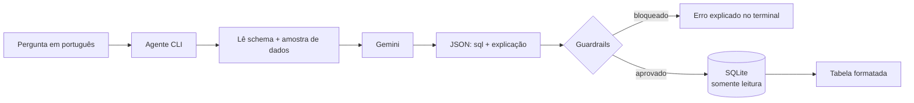

# Agente SQL 🗣️ → 🧾

**Pergunte em português. Receba a consulta SQL e a resposta do banco.**


> **Status:** versão inicial funcional (v0.1). O núcleo já funciona — pergunta → SQL → resultado — e as próximas etapas estão no [roadmap](#-roadmap).

---

## 💡 O problema

Ferramentas de análise de dados normalmente exigem duas habilidades ao mesmo tempo: entender o negócio **e** saber escrever SQL. Quem está começando costuma travar na sintaxe (JOIN, GROUP BY, funções de data) e acaba pedindo a consulta para outra pessoa.

Este projeto testa uma ideia simples: **e se a pessoa só precisasse perguntar?** O agente lê o schema do banco, entende a pergunta em linguagem natural e devolve o SQL, mas nunca executa nada sem passar por uma camada de validação.

O objetivo não é "deixar a IA solta no banco", o objetivo é: **usar a IA para escrever a consulta e usar engenharia para garantir que ela seja segura.**

---

## ⚙️ Como funciona



1. **Schema em contexto** — o agente lê o `CREATE TABLE` de cada tabela e algumas linhas de exemplo, para o modelo saber exatamente quais colunas existem.
2. **Geração** — a pergunta vai para o Gemini junto com o schema. A resposta é obrigada a vir em JSON (`{"sql": ..., "explicacao": ...}`), o que evita texto solto no meio.
3. **Validação** — o SQL passa pelos guardrails antes de qualquer coisa (regras abaixo).
4. **Execução** — a consulta roda em uma conexão aberta em **modo somente leitura** (`mode=ro`), como segunda barreira.
5. **Formatação** — o resultado sai como tabela no terminal, com números no formato brasileiro.

---

## 🛡️ Segurança (a parte mais importante)

O modelo pode errar — então o projeto assume que ele vai errar.

| Regra | Por quê |
|---|---|
| Só `SELECT` / `WITH` | O agente responde perguntas, não altera dados |
| Um comando por vez | Impede `SELECT 1; DROP TABLE ...` |
| Lista de palavras proibidas (`INSERT`, `UPDATE`, `DELETE`, `DROP`, `PRAGMA`, `ATTACH`...) | Bloqueia escrita e administração do banco |
| Comentários removidos antes de validar | Evita esconder comandos atrás de `--` ou `/* */` |
| `LIMIT` automático quando não houver | Evita despejar milhares de linhas no terminal |
| Conexão **read-only** no SQLite | Mesmo se a validação falhar, o banco recusa escrita |
| SQL inválido é mostrado, não executado | Erro vira mensagem clara, não exceção crua |

Cada uma dessas regras tem teste automatizado (`tests/test_guardrails.py`).

---

## 🧰 Stack

| Camada | Escolha | Por quê |
|---|---|---|
| Linguagem | Python 3.10+ | Legibilidade e ecossistema de dados |
| Banco | SQLite | Zero configuração: o projeto roda em qualquer máquina |
| LLM | Google Gemini (`generateContent`) | API estável e camada gratuita para estudar |
| Dependências | **nenhuma** (só biblioteca padrão) | `urllib`, `sqlite3`, `json`, `argparse` — nada de `pip install` |
| Testes | `unittest` | Já vem no Python |

---

## 📁 Estrutura

```
agente-sql/
├── agent.py              # CLI: pergunta → SQL → resultado
├── guardrails.py         # validação do SQL (o que pode rodar)
├── database.py           # conexão read-only, schema e execução
├── llm.py                # chamada à API do Gemini
├── seed.py               # cria o banco de exemplo (loja fictícia)
├── tests/
│   └── test_guardrails.py
├── .env.example          # modelo de configuração da chave
└── .gitignore            # protege o .env e o banco gerado
```

---

## ▶️ Como rodar

Pré-requisito: Python 3.10 ou superior.

```bash
# 1. clone o repositório
git clone https://github.com/LauraBatista934/agente-sql.git
cd agente-sql

# 2. crie o banco de exemplo
python seed.py

# 3. configure sua chave do Gemini
#    (copie .env.example para .env e cole a chave)
#    gere em: https://aistudio.google.com/apikey

# 4. pergunte
python agent.py "Quais foram os 5 clientes que mais gastaram?"
```

Se preferir usar variável de ambiente em vez do `.env`:

```bash
export GEMINI_API_KEY="sua_chave"      # Linux/macOS
set GEMINI_API_KEY=sua_chave           # Windows (cmd)
$env:GEMINI_API_KEY="sua_chave"        # Windows (PowerShell)
```

Opções da linha de comando:

```bash
python agent.py --schema                          # mostra o schema do banco
python agent.py "pergunta" --mostrar-sql          # mostra o SQL gerado
python agent.py "pergunta" --nao-executar         # só gera o SQL, não roda
```

---

## 💬 Exemplos de perguntas

- Quais foram os 5 clientes que mais gastaram?
- Qual a receita total por categoria de produto, sem contar pedidos cancelados?
- Qual é o ticket médio por canal de venda (site, app, loja)?
- Quantos pedidos foram cancelados por estado?
- Qual produto tem mais unidades em estoque e quanto isso representa em dinheiro?
- Qual mês de 2026 teve mais pedidos?

Saída esperada (trecho real):

```
Pergunta: Quais clientes mais gastaram?

Explicacao: Soma o valor dos itens por cliente, do maior para o menor.

SQL:
SELECT c.nome,
       SUM(i.quantidade * i.preco_unitario) AS total
FROM clientes c
JOIN pedidos p ON p.cliente_id = c.id
JOIN itens_pedido i ON i.pedido_id = p.id
GROUP BY c.nome
ORDER BY total DESC
LIMIT 100

nome             | total
-----------------+----------
Gabriela Dias    | 11.046,00
Ana Souza        | 10.425,20
Diego Rocha      |  8.172,30
...

10 linha(s).
```

---

## 🧪 Testes

```bash
python -m unittest discover -s tests -v
```

Os testes cobrem o caminho crítico: `SELECT` e `WITH` passam, escrita é bloqueada, múltiplos comandos são bloqueados, comentários não escondem comandos e `LIMIT` não é duplicado.

---

## 🧠 Decisões técnicas (e o que aprendi)

- **Guardrails em código, não no prompt.** Pedir "não use DELETE" para o modelo é sugerir, não garantir. A regra que vale é a que está no `if`.
- **Defesa em profundidade.** Validação textual + conexão read-only: duas barreiras independentes.
- **JSON estruturado em vez de texto livre.** Com `responseMimeType: application/json`, a resposta é previsível e o código não depende de expressão regular para achar o SQL.
- **Schema + amostra de dados.** Só o `CREATE TABLE` não conta que `status` usa `'entregue'` e não `'concluido'`. Mostrar 2 linhas reais reduz alucinação de valor.
- **Zero dependências.** `urllib` no lugar do SDK deixa explícito o que é HTTP, JSON e tratamento de erro — e o projeto roda em qualquer máquina sem `pip install`.
- **Erro é resposta.** Quando a API falha ou a consulta é bloqueada, o terminal explica o motivo e mostra o SQL recusado. Depurar às cegas é pior.

---

## 🗺️ Roadmap

- [x] Banco de exemplo com dados fictícios (`seed.py`)
- [x] Geração de SQL a partir de pergunta em português
- [x] Guardrails de somente leitura + lista de comandos proibidos
- [x] Conexão read-only e `LIMIT` automático
- [x] CLI com `--schema`, `--mostrar-sql` e `--nao-executar`
- [x] Testes automatizados dos guardrails
- [ ] Suporte a PostgreSQL (além do SQLite)
- [ ] Histórico de perguntas em SQLite, para reuso e comparação
- [ ] Conjunto de perguntas com SQL esperado + medição de acurácia do modelo
- [ ] Timeout de execução para consultas pesadas
- [ ] Interface web simples (Streamlit ou HTMX)
- [ ] Máscara de dados sensíveis (CPF, e-mail) no resultado

---

## 👩‍💻 Autora

**Laura de Freitas Macedo** — estudante de Análise e Desenvolvimento de Sistemas (Unisinos), com foco em desenvolvimento e IA aplicada.

[](https://github.com/LauraBatista934)
[](https://www.linkedin.com/in/lauradefreitasmacedo/)

---

## 📄 Licença

MIT — use, estude e adapte. Os dados do banco são fictícios, gerados por `seed.py`, e não representam nenhuma empresa real.
